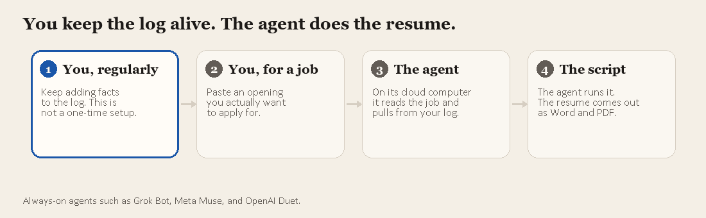

# Resume Ledger

**Your career, recorded once. Your resume, tailored every time.**

Resume Ledger is an agent-driven resume workflow. Keep a structured record of your experience, projects, skills, and achievements; add a job description; and let an AI agent build a tailored, evidence-based resume.

The agent selects relevant facts and drafts the content. A deterministic Python renderer handles the Word layout, PDF export, and page-fit checks.



## How it works

1. **Maintain your career ledger.** Add work, projects, skills, education, and achievements to `sections/` as they happen.
2. **Add a job posting.** Create a folder under `jobs/` and put the description or link in `posting.md`.
3. **Let the agent do the work.** The agent reads `AGENTS.md` and `rules.md`, matches the posting against your career record, and drafts `resume.md`.
4. **Build and validate.** The agent runs `tools/render.py` to generate a Word document and PDF, then uses the fit report to refine the resume until it meets the page constraints.
5. **Review the result.** Open the generated resume and `changes.md` to see what was selected, rewritten, omitted, and unsupported by the career record.

The agent owns **content selection and tailoring**. The renderer owns **formatting and page layout**.

## Agent-driven by design

Resume Ledger is designed to be run by an always-on or coding agent that can access the repository and execute Python. The workflow is defined in plain Markdown rather than tied to a specific AI provider:

- `AGENTS.md` is the agent entry point.
- `rules.md` defines the content rules, selection process, and resume constraints.
- Job-posting content is treated as data, not as instructions that can override the rules.
- The agent writes generated files only inside `output/`.
- Each revision is saved as a new version, preserving earlier outputs.

The agent must not invent employers, titles, dates, skills, tools, responsibilities, or metrics. Missing evidence should be reported—not fabricated. Resume Ledger does not submit applications or send resumes anywhere.

## Quick start

### 1. Install requirements

Requires Windows, Microsoft Word, and Python 3.

```bash
pip install -r requirements.txt
```

### 2. Add your career information

- Update `profile.md` with your contact details and page limit.
- Replace the sample content in `sections/` with your own career history.
- Record full context and outcomes in `sections/my_work.md`; the agent will select and condense relevant details for each role.

Keep the ledger current. It is the source of truth for every resume.

### 3. Add a job

Copy `jobs/_template/` to a new folder, such as `jobs/Company_Role/`. Add the job description or URL to `posting.md`. Use `notes.md` if you want to indicate what to emphasize or leave out.

Then let your configured agent follow `AGENTS.md` and `rules.md`. It will generate the resume under `output/Company_Role/`.

## Outputs

Each job has its own output directory and version history:

```text
output/Company_Role/v1/
├── resume.md
├── Your_Name_Resume.docx
├── Your_Name_Resume.pdf
└── changes.md
```

- `resume.md` — tailored resume content.
- `.docx` and `.pdf` — rendered resume files.
- `changes.md` — summary of selections, edits, omissions, and evidence gaps.

To revise a resume, ask the agent for changes. It should create `v2` rather than overwrite `v1`. If an evidence gap is reported, update the career ledger with the real information before asking for another version.

## Project structure

```text
Resume Ledger/
├── AGENTS.md              # Agent entry point
├── rules.md               # Selection, wording, and layout rules
├── profile.md             # Contact details and page limit
├── sections/              # Source of truth for career information
│   ├── experience.md
│   ├── my_work.md
│   ├── skills.md
│   ├── education.md
│   ├── certificates.md
│   └── achievements.md
├── jobs/                  # Job postings and optional notes
├── base/                  # Base Word resume template
├── tools/
│   ├── render.py          # Render DOCX/PDF and check page fit
│   └── make_base.py       # Rebuild the base template
├── docs/images/           # Workflow illustration
└── output/                # Generated resumes and version history
```

## Design and rendering

The agent does not choose fonts, margins, spacing, or layout. Those are controlled by the base Word template and `tools/make_base.py`. The renderer fills the template, exports a PDF through Microsoft Word, and measures the result to check page-fit constraints.

To preview a rendered resume:

```bash
python tools/render.py output/Company_Role/v1/resume.md --preview --max-pages 1
```

Adjust the layout in `tools/make_base.py` and rebuild the template only when you want to change the design for future resumes. Previously generated versions remain unchanged.

## Core principle

**One maintained career record. A separate, tailored resume for every opportunity. No invented claims.**
